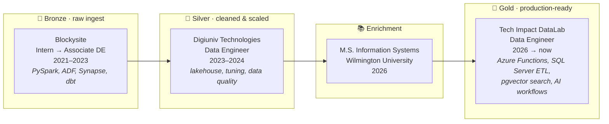

<div align="center">


<a href="https://www.linkedin.com/in/abhishek-reddy-manam"></a>


</div>

---

### `> query profile`

```sql
SELECT name, role, years_experience, home_stack, currently
FROM   engineers
WHERE  github_handle = 'Abhi-shek-reddy';
```

| name | role | years_experience | home_stack | currently |
|---|---|---|---|---|
| Abhishek Reddy Manam | Data Engineer @ Tech Impact (DataLab) | 3+ | Azure · Databricks · PySpark · Delta Lake | Shipping Azure pipelines & AI data backends · studying for DP-700 |

<sub>1 row returned · 0 nulls · schema validated ✓</sub>

---

### 🥉 → 🥈 → 🥇 &nbsp;My career, as a medallion pipeline



---

### 📊 Pipeline run metrics

| job | before | after |
|---|---|---|
| New-source onboarding (metadata-driven ADF, 40+ linked services) | 3 days | **< 2 hours** |
| Spark job latency (skew fixes, broadcast joins, partition sizing) | baseline | **~50% faster** |
| Data-quality incidents (Great Expectations + dbt tests as CI gates) | baseline | **~40% fewer** |
| Mean time to resolve incidents (runbooks for 15+ failure patterns) | 2 hours | **30 minutes** |
| CI build time (dbt Slim CI) | baseline | **70% shorter** |

---

### 🧰 Stack

**Azure** &nbsp;


**Lakehouse & processing** &nbsp;


**Warehouse & modeling** &nbsp;


**Orchestration, quality & code** &nbsp;


---

### ⏱️ Currently running jobs

```text
JOB                         STATUS     NOTE
dp700_fabric_certification  RUNNING    Microsoft Fabric Data Engineer, in progress
job_scout_pipeline          BUILDING   my own ETL that scrapes, scores and ranks job postings
open_to_work                ACTIVE     Data Engineer roles · US · remote / hybrid / onsite, happy to relocate
```

### ✅ Data quality checks on me

```yaml
expect_column_values_to_not_be_null:  [curiosity, ownership, documentation]
expect_column_values_to_be_unique:    "explains pipelines to non-engineers"
expect_table_row_count_to_increase:   skills   # every quarter
```

---

<div align="center">
<sub>Pipelines should be boring in production. Everything else can be interesting. · <a href="https://www.linkedin.com/in/abhishek-reddy-manam">Let's talk data</a></sub>
</div>
